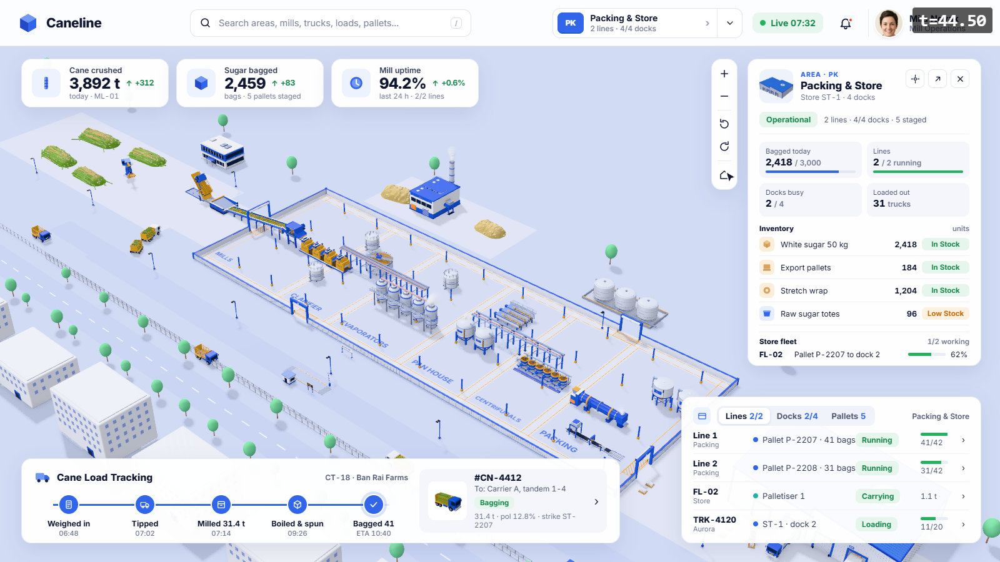
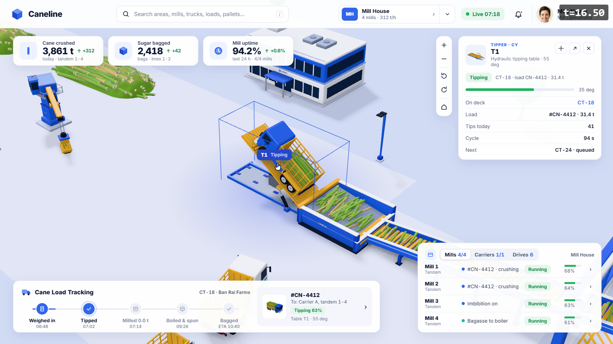
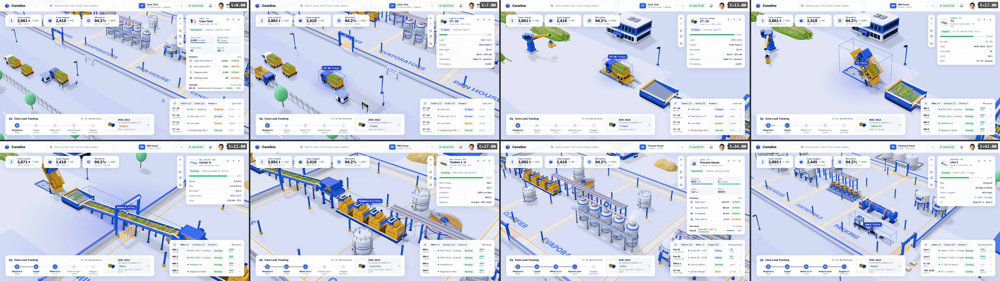

<h1 align="center">Caneline</h1>

<p align="center"><b>A sugar mill you can watch run itself.</b><br>
One offline HTML page. Every machine, every number and every frame is code.</p>

<p align="center"></p>

<p align="center">
<b>44.6 seconds</b> &nbsp;·&nbsp; <b>one camera</b> &nbsp;·&nbsp; <b>~5,000 lines</b> &nbsp;·&nbsp; <b>no 3D files, no downloads, no network</b>
</p>

---

## What it is

A toy-scale isometric sugar mill — **Suphan Mill, ML-01** — with a product UI laid over it. The whole plant runs on
one clock: the cane carrier, the four-mill tandem, the clarifier, five evaporator bodies, two vacuum pans, six
centrifugals running deliberately out of phase, the rotary dryer, two bagging lines and the boiler burning its own
bagasse. One camera pans and zooms across it and never cuts.

Open [`index.html`](index.html) in any browser. Nothing is fetched — three.js, the fonts and every model are inlined.

## The story it tells

You follow **one cane load, #CN-4412** — 31.4 t of Khon Kaen 3 from Ban Rai Farms — from the gate to a bagged pallet:

| | |
|---|---|
| **0.6–5.2 s** | CT-18 weighs in at WB-1. Gross 44.6 t, tare 13.2 t. |
| **5.8–12.6 s** | It runs the internal road west past the mill house, and the camera rides with it. |
| **13.2–18.8 s** | It drives forward up the tipping table's bridge ramp, the deck lifts its nose to 53°, and the load goes east over the tailgate into the receiving hopper. |
| **15.4–23.4 s** | The cane climbs the 38 m slat carrier from y 1.2 to 6.4 and in through the hall's west door. |
| **20.5–28.0 s** | The shredder and the four-mill tandem crush it. Juice to the tray, bagasse to the boiler. |
| **26.0–33.5 s** | The clarifier, then five evaporator effects take it to syrup. |
| **32.0–39.0 s** | Pan 01 boils strike #ST-2207; the centrifugals spin it white. |
| **37.0–42.4 s** | The dryer, then bag 1 of pallet P-2207 rides the bagging belt. |
| **40.4–44.6 s** | FL-02 carries P-2207 out to Store ST-1, dock 2, and the camera pulls back over the whole mill. |

Every panel on screen reads from that same clock. The tracker ticks over as the load moves, the mill torques and the
pan's strike are the scene's own numbers, and the area switcher walks Cane Yard → Mill House → Process House →
Packing & Store as the camera gets there.

<p align="center"></p>

## The rules it follows

| | |
|---|---|
| **One camera** | Azimuth 42°, elevation 34°, for the whole film. It pans and zooms. No cuts. |
| **`render(t)` is pure** | Any second renders the same frame in any order. No physics, no timers, no state between frames. |
| **Toy scale** | A cane truck nearly as tall as the hopper. Big simple shapes, generous bevels, nothing sharp. |
| **Two colours** | Blue and white on a lavender ground. Yellow only on the working machines — the mill rollers, the tipping table, the carrier slats, the cane cage. Green only on cane. |
| **Nothing above y = 12** | At 34° a tall column hides the work behind it. The one exception is the boiler stack, at the back where it blocks nothing. |
| **It is swept for collisions** | Oriented boxes from each body's own geometry, every 0.1 s across all 44.6 s. The sweep currently reports nothing. |

## The beats

<p align="center"></p>

## Run it

Open `index.html`. That is the whole thing.

To publish it, push this repository and turn on GitHub Pages (Settings → Pages → Source: GitHub Actions). The
[workflow](.github/workflows/pages.yml) serves the committed page as-is; there is nothing to compile in CI.

While it is open: `space` pauses, `←`/`→` seek two seconds, `r` restarts, `f` goes fullscreen.

## Build it

The sources in `src/` are written against the kit in the [`Nyxera0x/simulator`](https://github.com/Nyxera0x/simulator)
Claude Code skill — its stage and lighting, its product UI, its selection marks, and its airport, car-plant and
construction-site model kits, which Caneline reuses for the box trucks, forklifts, pallets, hall, fences and trees.
That kit is not a published npm package, so the build borrows it from an installed copy of the skill.

```bash
npx skills add Nyxera0x/simulator -g -a claude-code
```

```bash
cd ~/.claude/skills/simulator && npm install && npx playwright install chromium
```

Then, back in this repository:

```bash
npm run build
```

`scripts/build.mjs` finds the installed skill (or `SIMULATOR_SKILL_DIR`), copies `src/*` into its `sims/` folder, runs
its bundler and copies the single self-contained HTML file back here as `index.html`. Node 20 or newer.

To re-run the collision sweep:

```bash
npm run collide
```

## What is inside

| | |
|---|---|
| `index.html` | The built page. Self-contained, offline, ~1 MB. This is the deliverable. |
| `src/sugar-shared/palette.js` | The mill's colours on top of the kit's, and the shared helpers: lathed vessels, pipe runs, walkways, plumes. |
| `src/sugar-shared/wet.js` | The wet end: cane carrier, receiving hopper, shredder, four-mill tandem, juice tanks, clarifier, five evaporator bodies, pipe racks. |
| `src/sugar-shared/dry.js` | The dry end: vacuum pans, crystallisers, six centrifugals, rotary dryer, silos, bagging line, sugar bags and pallets, boiler house. |
| `src/sugar-shared/yard.js` | The yard: cane trucks and trailers, the tipping table, the weighbridge, cane and bagasse piles, the pedestal grab, gate, office, tank farm. |
| `src/sugar-shared/world.js` | The map and the whole crushing day as `pose(t)` — every path, every machine's state, the numbers the UI reads. |
| `src/sugar-shared/film.js` | The camera keys, the eleven clicks, the area switcher and every panel of the Caneline UI. |
| `src/sugar-film/` | The film's entry point and its timeline. `src/sugar-collide/`: the collision sweep. |
| `docs/BRIEF.md` | The brief the three model kits were built from, including the scale contract every height in the mill meets. |

## Credits

Built with the [`Nyxera0x/simulator`](https://github.com/Nyxera0x/simulator) skill, which supplies the look, the
stage, the product UI and the vehicle and building kits Caneline reuses.

The mill, its sites, its loads, its staff and its numbers are fictional.

## License

MIT — see [LICENSE](LICENSE).
